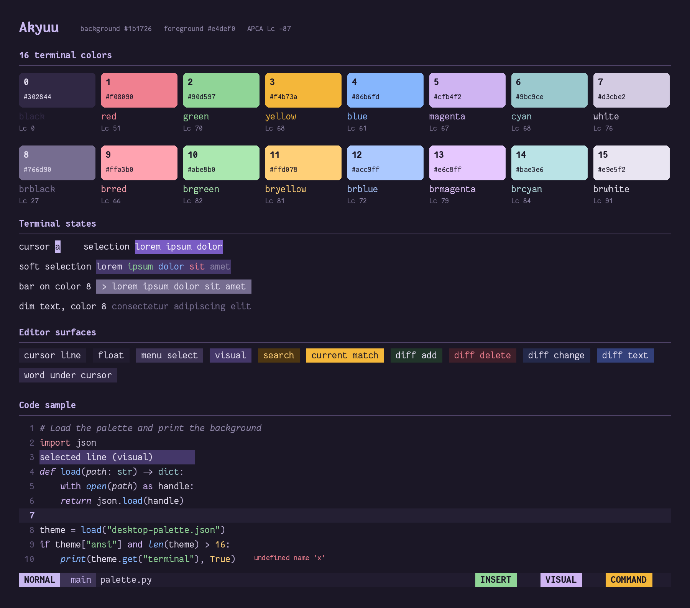
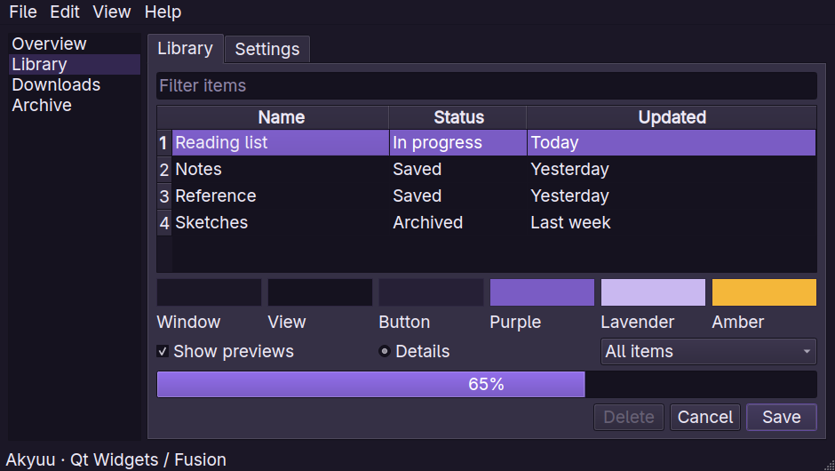

# Akyuu colors

A dark purple color scheme with lavender accents and amber highlights.
Includes a KDE color scheme and palettes for qt5ct and qt6ct.

## Palette



## Qt preview



The Qt preview uses Qt Widgets with Fusion.

## Install

Copy the KDE scheme to your user color-scheme directory:

```sh
install -Dm644 Akyuu.colors "${XDG_DATA_HOME:-$HOME/.local/share}/color-schemes/Akyuu.colors"
```

Select **Akyuu** in Plasma's Colors settings or in the application's color-scheme
menu. For Qt applications outside Plasma, follow the [Qt 5/6 guide](docs/Installation.md).

## Documentation

- [Installation](docs/Installation.md)
- [Troubleshooting](docs/Troubleshooting.md)
- [Regenerating the Qt palettes](docs/Development.md)

## License

[GPL-3.0-or-later](LICENSE). See [COPYRIGHT](COPYRIGHT) for copyright information.
